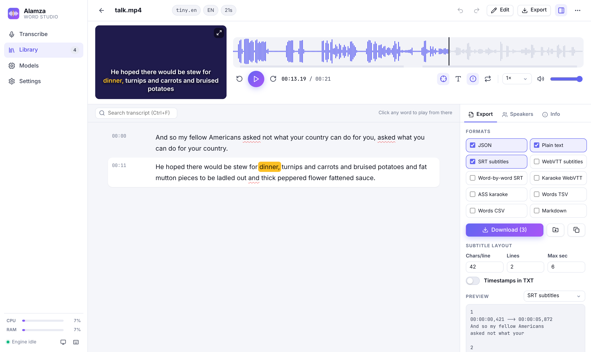

<p align="center"></p>
<h1 align="center">Alamza Word Studio</h1>
<p align="center">Private, offline, <b>word-by-word</b> transcription for Windows, powered by WhisperX.<br>
Runs on a normal CPU (no graphics card needed) and lives quietly in the system tray.</p>



## Features

- **Every Whisper model**: tiny → large-v3, the `.en` versions, Distil Large v3/v3.5 and Large v3 Turbo, with size, speed, accuracy and time estimates for *your* PC.
- **Word-level timestamps** via WhisperX alignment (standard or precise aligner).
- **Read-along player**: each word lights up as the audio/video plays. Waveform with speaker lanes and zoom, video captions, click any word to jump there, loop a segment, speed control.
- **Speaker detection** (optional, off by default): rename speakers, see talk time, reassign segments.
- **Editor**: fix words inline, split/merge segments, find & replace, undo/redo, autosave, revert to original, low-confidence words underlined.
- **Exports**: JSON, TXT, SRT, VTT, word-by-word SRT, karaoke VTT, ASS karaoke, TSV, CSV (Excel), Markdown. Live preview, subtitle layout controls, ZIP download, auto-export to a folder.
- **Queue**: drop many files at once, live progress, ETA, cancel anytime. Models stay loaded between files.
- **Tray app**: no taskbar window. Click the icon near the clock to open the UI, right-click to copy the link, open the output folder, toggle start-with-Windows or quit.
- Light/dark themes, keyboard shortcuts (`?`), desktop notifications, optional LAN access, REST API (`/api/docs`).

## Install (Windows 10/11)

The app is **fully portable**: Python, packages, models, transcripts and settings all live inside its folder.

1. Download this repo (green **Code** button → **Download ZIP**) and extract it somewhere you can write to, e.g. `C:\Apps\alamza-word-studio`, `D:\` or a USB drive (not `Program Files`).
   Or with Git:
   ```bash
   git clone https://github.com/Mr-Hamza-Javed/alamza-word-studio.git
   ```
2. Double-click **`install.bat`**. It will:
   - download a private Python (~10 MB) into `runtime\` (your PC's own Python, if any, is not touched),
   - install WhisperX (CPU) and the app components into `runtime\`,
   - download only the small **Tiny English** model (~75 MB) into `models\`. Pick and download bigger, more accurate models from the app's **Models** page whenever you need them,
   - optionally add Start Menu / Desktop shortcuts and start-with-Windows,
   - launch the app.
3. The app opens at **http://127.0.0.1:7865/** and its icon appears in the tray (bottom-right, near the clock; it may be under the `^` arrow).

The first transcription also downloads the word aligner (~360 MB, needed for word-by-word timing) once. After that, and after downloading the models you want, everything works offline.

### Use it on another PC

Copy the whole folder (USB, network, ZIP) and double-click **`Alamza Word Studio.cmd`**. Nothing is downloaded or installed. To add Start Menu / Desktop shortcuts there, right-click the tray icon → **Add Start Menu and Desktop shortcuts** (or Settings → General).

**Update:** run `update.bat`. **Remove:** run `uninstall.bat` (removes shortcuts), then delete the folder.

## Which model should I use?

On an Intel Core i7 laptop (e.g. i7-1355U, 32 GB RAM) with English audio:

| Goal | Model | ~Time for 1 hour of audio |
|---|---|---|
| Quick draft | `small.en` | 10–20 min |
| **Best balance (recommended)** | `distil-large-v3` | 30–50 min |
| Highest accuracy, fewer repeats | `large-v3-turbo` | 40–70 min |
| Absolute best, slow | `large-v3` | 2–3 h |

Plug in the charger and set Windows power mode to **Best performance**; on battery, transcription can be 2–3× slower.

## Speaker detection

Off by default. To use it, create a free Hugging Face account, open
[pyannote/speaker-diarization-community-1](https://huggingface.co/pyannote/speaker-diarization-community-1) and accept the terms, then create a **Read** token at [huggingface.co/settings/tokens](https://huggingface.co/settings/tokens) and paste it in **Settings → Speakers**.

## Folder layout

| Folder | What's inside |
|---|---|
| `runtime\` | Private Python, packages, FFmpeg |
| `models\` | Whisper models, word aligner, speaker models |
| `data\` | Transcripts, uploaded media, settings, logs |
| `exports\` | Auto-exported files (auto-export is off by default; the Download button saves through your browser) |

## For developers

```
wordstudio/       Python backend (FastAPI server, job queue, WhisperX worker, exporters, tray)
ui/               React + Vite source for the web UI
web/              Built UI (committed, so users don't need Node.js)
scripts/          Windows installer / uninstaller
```

Run the server without the tray (any OS):

```bash
python run.py --no-tray
```

Work on the UI with hot reload (proxies `/api` to the running server):

```bash
cd ui && npm install && npm run dev
```

Build the UI into `web/` before committing:

```bash
cd ui && npm run build
```

Transcription runs in a separate worker process, so cancelling a job stops it instantly and the loaded model is reused for the next file.

## Credits

[WhisperX](https://github.com/m-bain/whisperX), [faster-whisper](https://github.com/SYSTRAN/faster-whisper), OpenAI Whisper, [pyannote.audio](https://github.com/pyannote/pyannote-audio).
